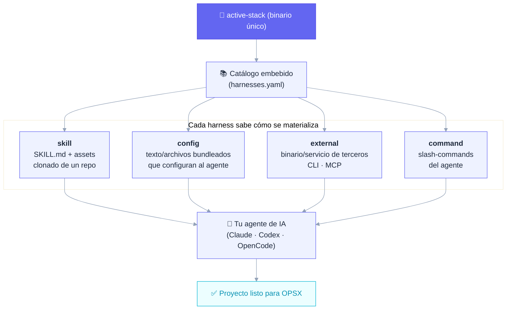
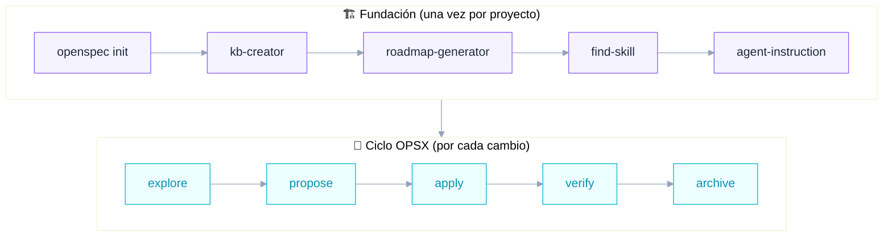

<p align="center">
  
  
  
  
  
  
</p>

<p align="center">
  <b>Un binario. Un catálogo de harnesses. Tu agente de IA listo para trabajar con método.</b>
</p>

---

## ¿Qué es esto?

**Active Stack** es un **instalador _methodology-first_**: un único binario en Go que toma tu agente de IA (Claude Code, Codex, OpenCode…) y le **inyecta, de forma modular y actualizable, todo el sustrato que exige una metodología de desarrollo asistido por IA.**

No es un framework que corre en tu app. Es un **configurador del entorno del agente**. Corrés un comando, elegís un modo, y el stack deja tu proyecto listo para el ciclo **OPSX** (`explore → propose → apply → verify → archive`). Por defecto instala el [flujo compacto de cinco roles](docs/lean-agent-workflow.md): el agente principal orquesta y reparte cada fase entre planificador, revisor del plan, constructor, rompedor y auditor, con TDD obligatorio y profundidad según el riesgo del cambio.

La idea central, en una frase:

> **Active Stack es un harness que instala harnesses.**

Un *harness* es cualquier módulo que prepara o guía el entorno de la IA. Active Stack lleva embebido un **catálogo maestro** de harnesses y sabe cómo materializar cada uno según su tipo.

### ¿Qué NO es?

Para que quede claro el alcance (decisiones firmes de diseño):

- ❌ No es un code-reviewer en commit.
- ❌ No instala themes, statusline ni keybindings (nada cosmético).
- ❌ No es un producto de marketing ni "supercharge any agent".

Es una herramienta enfocada: **instalar y configurar el sustrato metodológico, nada más.**

---

## El concepto: un harness de harnesses



Hay **cuatro tipos** de harness, y el instalador no instala "repos": instala harnesses, y cada uno declara cómo se baja/configura.

| Tipo | Qué es | De dónde sale | Ejemplos |
|------|--------|---------------|----------|
| **`skill`** | `SKILL.md` + assets, cargada bajo demanda | repo propio o de terceros, se clona al instalar | `kb-creator`, `roadmap-generator`, `active-orchestrator`, `find-skill` |
| **`config`** | Texto/archivos que configuran al agente | bundleado en el binario | `sdd-orchestrator`, `permissions`, `role-definitions` |
| **`external`** | Binario/servicio de terceros | se instala/configura (no es nuestro) | `OpenSpec`, `Engram`, `Context7` |
| **`command`** | Slash-commands nativos del agente | bundleado en el binario | `/active:init`, `/opsx:ship`, `/opsx:verify` |

---

## 📥 Descargas

<p align="center">
  <a href="https://github.com/Group-Active-IA/active-stack/releases/latest/download/ActiveStack-Setup.exe">
    
  </a>
</p>

| Plataforma | Descarga |
|------------|----------|
| **Windows** (instalador gráfico) | [`ActiveStack-Setup.exe`](https://github.com/Group-Active-IA/active-stack/releases/latest/download/ActiveStack-Setup.exe) — última versión |
| **Windows** (solo CLI) | [`active-stack_windows_amd64.exe`](https://github.com/Group-Active-IA/active-stack/releases/latest/download/active-stack_windows_amd64.exe) |
| **Linux / WSL** (solo CLI) | [`active-stack_linux_amd64`](https://github.com/Group-Active-IA/active-stack/releases/latest/download/active-stack_linux_amd64) |
| Todas las versiones | [Releases](https://github.com/Group-Active-IA/active-stack/releases) |

Cada release publica su [`SHA256SUMS.txt`](https://github.com/Group-Active-IA/active-stack/releases/latest/download/SHA256SUMS.txt) para verificar la integridad de lo descargado.

> ⚠️ **SmartScreen**: el instalador no está firmado digitalmente (todavía). Si Windows muestra la advertencia, hacé click en **"Más información" → "Ejecutar de todas formas"**. Podés verificar el hash SHA256 antes de ejecutar.

---

## Requisitos previos

**Para compilar desde fuente** (`build.bat` / `build.sh`):

| Dependencia | Para qué | Descarga |
|---|---|---|
| **Go 1.26+** | Compila el binario `active-stack` | [go.dev/dl](https://go.dev/dl/) |

**Para que el instalador funcione** (aplica tanto si compilaste desde fuente como si bajaste el binario o el `.exe` de [Releases](https://github.com/Group-Active-IA/active-stack/releases)):

| Dependencia | Para qué | Descarga |
|---|---|---|
| **Git** | El instalador clona harnesses de tipo `skill` | [git-scm.com/install/windows](https://git-scm.com/install/windows) |
| **Node.js** (LTS) | El instalador instala harnesses `external` vía `npm` (ej. OpenSpec CLI) | [nodejs.org/es/download](https://nodejs.org/es/download) |

Además, necesitás tener ya instalado un [agente de IA soportado](#agentes-y-plataformas) (Claude Code, Codex u OpenCode) — sin uno, no hay nada que el instalador pueda configurar.

> 💡 Go **no** hace falta para instalar ni para correr los binarios/`.exe` de Releases — solo para compilar desde fuente.

---

## Quick start

```bash
# 1. Cloná y compilá
git clone https://github.com/Group-Active-IA/active-stack.git
cd active-stack
go build -o active-stack ./cmd/active-stack

# 2. Instalá el stack (TUI interactiva)
./active-stack install
```

### Modos de uso del comando

```bash
active-stack install                 # TUI interactiva (Bubbletea): elegís agente y modo
active-stack install --dry-run       # Muestra el plan de instalación, no ejecuta nada
active-stack install --mode full     # Instalación headless (no interactiva)
active-stack install --agent claude  # Apuntá a un agente concreto
active-stack install --mode full --toggles lean-workflow,evidence  # Elegí los toggles del orquestador
active-stack install --help          # Todos los flags
```

Pasar `--mode`, `--agent` o `--toggles` activa el modo **headless** automáticamente (ideal para CI o scripts). `--toggles` reemplaza la lista del catálogo: sin `lean-workflow` instala la composición legacy, y un nombre desconocido falla antes de instalar mostrando los válidos.

> 💡 **¿Usuario final en Windows?** Una vez que tengas el binario (`active-stack.exe`), hacé **doble-click** para arrancar la TUI: autodetecta tus agentes instalados y te guía paso a paso — sin escribir un solo flag ni abrir una terminal.

---

## Modos de instalación

El catálogo agrupa los harnesses en tres presets. Convención: un harness de Lite también está en Full (Full incluye a Lite); Custom te deja elegir uno por uno.

| Modo | Qué instala | Para qué |
|------|-------------|----------|
| **Lite** | El **sustrato** mínimo: `openspec`, `engram`, `context7`, `sdd-orchestrator`, `permissions`, `role-definitions`, `starter-add-command` (el harness *Agent Slash-Commands*) | Empezar a trabajar con la metodología ya |
| **Full** | Sustrato **+ fundación guiada**: `active-orchestrator` y las skills de fundación (`kb-creator`, `project-scaffold`, `roadmap-generator`, `agent-instruction`, `skill-registry`, `web-scraper`, `discovery-research`, `find-skill`, `skill-creator`) | El ecosistema completo, proyecto desde cero |
| **Custom** | Vos elegís cada harness | Control total — con una excepción 👇 |

> 🔒 **`permissions` no es desactivable.** Incluso en Custom, el harness de seguridad (permisos *security-first*) queda forzado. La seguridad no es opcional.

---

## El catálogo de harnesses

Lo que Active Stack puede instalar hoy (fuente de verdad: [`internal/catalog/harnesses.yaml`](internal/catalog/harnesses.yaml)):

| Harness | Tipo | Modo | Qué hace |
|---------|------|------|----------|
| **OpenSpec CLI** | external | lite · full | CLI de Spec-Driven Development; fuente de verdad del estado |
| **Engram** | external | lite · full | Memoria persistente local (SQLite + FTS) vía MCP; no se registra de nuevo si Claude ya tiene el plugin `engram@engram` |
| **Context7** | external | lite · full | Documentación de librerías al día (MCP remoto) |
| **SDD Orchestrator** | config | lite · full | Orquestador SDD componible por toggles (`lean-workflow` por defecto; compatibilidad: `delegation`, `model-routing`, `governance`, `evidence`, `auditor`, `roles`, `review`, `knowledge-base`, `senior`, `ship`, `engram`, `tdd`) |
| **Role Definitions** | config | lite · full | Cinco roles de flujo (planificador, revisor del plan, constructor, rompedor, auditor) y siete especialistas opcionales, sin modelo fijo; en Claude como `role-*.md` en su directorio de agentes |
| **Permissions** | config | lite · full | Permisos seguros por defecto (bloquea `.env`, confirma git destructivo) — **no opcional** |
| **active-orchestrator** | skill | full | Orquestador delgado de la fase de fundación |
| **kb-creator** | skill | full | Genera la knowledge-base canónica del dominio |
| **project-scaffold** | skill | full | Genera la documentación de proceso: el par `CLAUDE.md`/`AGENTS.md`, README, CONTRIBUTING y skills del stack |
| **roadmap-generator** | skill | full | Genera `CHANGES.md` (backlog técnico) desde la KB |
| **agent-instruction** | skill | full | Genera `AGENTS.md`/`CLAUDE.md` con todas las referencias |
| **skill-registry** | skill | full | Crea/actualiza el registro de skills del proyecto |
| **web-scraper** | skill | full | Investiga competidores desde una URL, sin API keys ni costos extra |
| **discovery-research** | skill | full | Fase de Discovery/Investigación (11 puntos) antes de armar la Knowledge Base |
| **Agent Slash-Commands** | command | lite · full | Los slash-commands nativos del agente (`/active:init`, `/active:starter-add`, `/opsx:ship`, `/opsx:verify`) |
| **find-skill** | skill (terceros) | full | Busca y recomienda skills relevantes |
| **skill-creator** | skill (terceros) | full | Crea nuevas skills siguiendo la spec de Agent Skills |

El **`sdd-orchestrator`** es el harness clave: es de tipo `config` y se compone a partir de **toggles modulares**. El resultado es el bloque de instrucciones del orquestador que se inyecta en el `CLAUDE.md` / `AGENTS.md` de tu proyecto.

Por defecto `lean-workflow` selecciona el [flujo compacto de cinco roles](docs/lean-agent-workflow.md). El agente principal coordina planificador → revisor del plan → constructor → rompedor → auditor. Cada fase OPSX tiene sus roles (propose: planificador y revisor; apply: constructor; verify: rompedor y auditor), la profundidad escala con LOW/MEDIUM/HIGH/CRITICAL y cada proyecto declara quién ejecuta cada rol en `## Role executors` (subagente de Claude, Codex u otro proveedor). TDD es obligatorio para código; senior y especialistas no agregan etapas automáticamente.

Toggles del `sdd-orchestrator` (lista canónica: `config.KnownToggles()`; el orden no cambia el resultado). Con `lean-workflow` activo sólo `governance`, `evidence`, `knowledge-base`, `engram` y `ship` agregan su contrato compacto; los marcados **sólo legacy** se aceptan por compatibilidad pero no pueden apagar nada del flujo lean (TDD y auditor son siempre obligatorios). Se eligen con `active-stack install --toggles`:

- `lean-workflow` (selector) — selector predeterminado; quitarlo activa la composición legacy.
- `delegation` (sólo legacy) — reglas de delegación: qué resolvés inline y qué mandás a un sub-agente, para no inflar el contexto.
- `model-routing` (sólo legacy) — qué modelo usa cada fase del ciclo, con sustitución declarada si no tenés acceso al asignado.
- `governance` (lean y legacy) — cuánta autonomía tiene el agente según la criticidad del dominio que toca (CRITICAL, HIGH, MEDIUM, LOW).
- `evidence` (lean y legacy) — reporte tipado: cada afirmación etiquetada EVIDENCIA, JUICIO o SUPOSICIÓN, y la evidencia exige comando, salida y hora.
- `auditor` (sólo legacy) — alguien lee a los revisores: marca evidencia sin comando, salida vieja y suposiciones ascendidas a evidencia.
- `roles` (sólo legacy) — convoca un rol con estándar fijo y "listo" observable, en vez de fabricar un sub-agente genérico distinto cada vez.
- `review` (sólo legacy): un rompedor con tres lentes obligatorias y bucle de hasta tres vueltas; el auditor decide y el orquestador ejecuta.
- `knowledge-base` (lean y legacy): en archive reescribe la base que impacto y diff tocaron; agrega decisiones, lecciones L-NNN y deuda del auditor con evidencia por entrada. Sólo APPEND sin REWRITE se reporta SUSPICIOUS: append-only.
- `senior` (sólo legacy): sólo en verify, después del rompedor y antes del auditor; aporta contexto de decisiones fechadas, uno por vuelta y hasta tres por change.
- `ship` (lean y legacy) — publicar en GitHub el trabajo de un change cerrado: no corre comandos fijos, diagnostica dónde está parado el repositorio y decide. Push a `main` siempre pregunta, push a una rama propia no; PR o directo se propone con fundamento; espera el CI completo sobre el SHA pusheado y nunca mergea el PR.
- `engram` (lean y legacy) — memoria persistente entre sesiones y compactaciones, cableada a las fases OPSX.
- `tdd` (sólo legacy) — en lean TDD es siempre obligatorio y este toggle no cambia nada; en legacy: TDD estricto en la fase apply: no hay código de producción sin un test que falle primero.

---

## Cómo funciona la instalación

`active-stack install` no copia archivos a lo bruto. Resuelve dependencias, hace backup, inyecta con markers idempotentes y verifica:

```mermaid
%%{init: {'theme':'base','themeVariables':{'primaryColor':'#eef2ff','primaryBorderColor':'#6366f1','primaryTextColor':'#1e293b','lineColor':'#94a3b8','fontFamily':'sans-serif'}}}%%
flowchart LR
    A["1 · Detectar<br/>OS · arch · agentes · deps"] --> B["2 · Elegir<br/>agente(s)"]
    B --> C["3 · Elegir modo<br/>Lite · Full · Custom"]
    C --> D["4 · Resolver catálogo<br/>árbol de dependencias"]
    D --> E["5 · Backup<br/>de configs existentes"]
    E --> F["6 · Instalar<br/>externals + harnesses"]
    F --> G["7 · Inyectar configs<br/>merge por markers"]
    G --> H["8 · Verificar<br/>health checks"]

    classDef safe fill:#fef2f2,color:#b91c1c,stroke:#f87171;
    class E,G safe;
```



Tres garantías **no negociables** del instalador (los pasos marcados arriba en rojo):

- 🛟 **Nunca pisa tu config sin backup** — snapshot antes de escribir, con restore.
- 🧩 **Inyección idempotente por markers** — reinstalar no duplica bloques.
- ↩️ **Rollback por etapas** — si un paso falla, deshace lo hecho (sin tocar lo que ya existía).

### Instalar sobre una configuración previa

- Un `role-*.md` idéntico a una versión que el stack ya publicó se respalda y se actualiza. Uno desconocido (personal o editado) no se toca: la versión del stack queda al lado como `<archivo>.active-stack.md` y el conflicto se informa. Si es uno de los cinco roles del flujo, se marca **BLOQUEANTE** y el mensaje final dice que el flujo lean no puede correr hasta resolverlo (el exit code sigue en 0).
- El instalador nunca borra archivos que no pueda probar propios.
- Las skills no se vuelven a clonar si el commit remoto no cambió y la copia instalada sigue intacta: una consulta `git ls-remote` por skill en vez de un clon completo (una reinstalación pasa de ~21 s a ~7 s). Si la consulta falla, se clona como siempre.
- El snapshot de la instalación guarda cada archivo de comandos y skills que se va a pisar, no sólo la carpeta: cada instalación guarda su propio snapshot en `~/.active-stack/backups/install-<fecha>/`, y `active-stack uninstall --strategy restore --restore-manifest <esa carpeta>/manifest.json` devuelve tu configuración tal como estaba antes de esa instalación, con contenido y permisos. Los archivos de configuración conservan sus permisos al reescribirse (un `opencode.json` 600 sigue en 600). Los binarios que descargó la instalación (por ejemplo `engram` en `~/.local/bin`) quedan, y el restore lo avisa.
- Se verificó instalando, reinstalando y restaurando en un HOME aislado, incluido un home con roles personales y una skill propia editada.

---

## De la instalación al código

Una vez instalado el stack, hay **una fase de fundación** (una vez por proyecto) y después el **ciclo iterativo** (una vez por cambio):



El `active-orchestrator` coordina la fundación con lazy-loading de skills; durante el ciclo, **OpenSpec CLI es la fuente de verdad del estado** y el orquestador delega el trabajo pesado a sub-agentes.

El ciclo es `explore → propose → apply → verify → archive`, seguido de `ship` cuando se publica. Con `lean-workflow` (predeterminado) el orquestador tiene todos los recursos y asigna los roles dentro de cada fase:

| Fase | Roles | Qué se entrega |
|---|---|---|
| `propose` | planificador → revisor del plan | propuesta, diseño, tareas y escenarios revisados; HIGH/CRITICAL esperan tu aprobación escrita |
| `apply` | constructor | código con TDD: RED observado antes de producción, GREEN y evidencia en `tasks.md` |
| `verify` | rompedor → auditor | fallos reproducidos vuelven al constructor; el auditor da APROBADO o BLOQUEANTES con deuda y lecciones |
| `archive` | orquestador | cierre con APROBADO y actualización de la base de conocimiento y `obsidian.md` |

La profundidad escala con el nivel del change: en **LOW** el orquestador puede planificar y revisar él mismo y hay una ronda del rompedor; desde **MEDIUM** corren cinco agentes separados; **HIGH** suma regresiones de consumidores y mutantes en lo clave; **CRITICAL**, mutantes en cada aserción de seguridad o datos y un recorrido real si hay login externo. Cada encargo es autosuficiente (contrato del rol, formato de informe y contexto acotado), así que cualquier rol puede ejecutarlo Claude, Codex u otro proveedor según la tabla `## Role executors` del proyecto. Detalle en la [guía del flujo](docs/lean-agent-workflow.md).

**Modo legacy** (al quitar `lean-workflow`), sin cambios:

- **Propose:** con governance activo, ALTO o CRÍTICO requiere informes de arquitecto, analista funcional y QA, más especialistas por capa, convocados de a uno sin leer los otros informes; el auditor lee los N originales antes de la aprobación humana escrita. La tabla `## Aprobación` registra elección, persona, fecha y alcance; ningún agente la completa. Una regla nueva necesita aprobación propia.
- **Apply constructor:** rojo y verde por tarea en `tasks.md`, con comando, salida, hora y SHA; si el test nació verde, mutante que falle en su aserción y se revierta. Declara consumidores, conflictos y familia del modelo. En vueltas 2 y 3 corrige sólo la lista del auditor.
- **Verify:** conformidad → rompedor con tres lentes (correctitud, cableado, documentación) → senior si está activo → auditor. La conformidad sola no habilita archive. El auditor decide y el orquestador ejecuta; sólo APROBADO con informes completos y conformidad satisfecha habilita el cierre ordinario. El contador y los informes viven en el change: máximo tres vueltas, sin cuarta automática. En la tercera con bloqueantes se exige decisión humana escrita sobre alcance nuevo, deuda justificada o freno; no se fabrica APROBADO.
- **Archive:** lee la unión del impacto declarado y el diff; reescribe las descripciones actuales y agrega decisiones, lecciones numeradas y deuda del auditor con fecha, costo y evidencia tipada. Deja `knowledge-base-report.md` por change con REWRITTEN, APPENDED y PENDING por documento; sólo APPEND se justifica y se señala como `SUSPICIOUS: append-only` cuando correspondía reescribir.
- **Ship:** espera todo el CI requerido sobre el SHA pusheado, inspeccionando workflows, eventos y jobs. En active-stack exige `ci.yml` en push con tests Ubuntu y Windows; en otros repos deriva su conjunto. Cero runs, consulta fallida, SHA ajeno o estados incompletos no confirman entrega. `main` exige permiso y nunca se mergea el PR automáticamente.

Si falta un toggle se declara la degradación; sin review no hay rompedor ni bucle. Sin auditor se necesita decisión escrita de la persona responsable para cerrar con alcance degradado. Un informe obligatorio faltante detiene el cierre.

**EVIDENCIA:** commits y límites de fase 1 en la [base metodológica](docs/metodologia-opsx.md), con decisiones, lecciones y deuda. `active-stack version` informa versión y SHA disponibles; los checks validan identidad del binario, `roles --help` y entrega contra `Compose`. Estado actual del proyecto: [docs/ESTADO.md](docs/ESTADO.md).


---

## Agentes y plataformas

**Agentes soportados hoy** (con adapter funcional):

| Agente | Estado |
|--------|--------|
| **Claude Code** | ✅ Soportado |
| **Codex** | ✅ Soportado |
| **OpenCode** | ✅ Soportado |
| Gemini · Cursor · VS Code · Windsurf · Antigravity | 🔜 En el modelo de dominio, adapter en roadmap |

> Agregar un agente es deliberadamente barato: un sub-paquete con el adapter + una entrada en el registry. Ningún installer ni interfaz existente cambia.

**Plataformas:** Windows, Linux y WSL (amd64). macOS y Termux no tienen binario publicado.

---

## Captura de informes por proveedor

`active-stack reports capture` importa un archivo explícito por despacho mediante
`--source-provider`, `--source-version`, `--source-session` y `--report`.
Admite Codex exec 0.132.0 JSONL y Claude Code 2.1.271 (Handback seguido de
SubagentStop; requiere además `--source-agent`). No descubre sesiones personales
ni instala hooks. OpenCode y las versiones sin contrato confirmado devuelven
UNSUPPORTED; eventos incompletos o informes vacíos quedan PENDING. Un secreto
detectado, incluso en un evento parcial, queda RETAINED (RETENIDO), local e
ignorado por Git. Contratos, fixtures y límites en
[internal/reports/testdata/README.md](internal/reports/testdata/README.md).
El ciclo automático de hooks de 2b permanece pendiente; importar eventos no
acredita esa integración.

---

## Arquitectura

Active Stack es Go 1.26 + [Bubbletea](https://github.com/charmbracelet/bubbletea)/Lipgloss para la TUI, con el catálogo embebido en el binario vía `//go:embed`.

```
cmd/active-stack/            entrypoint CLI (install, uninstall, roles, reports, starter, version)
  headless/              ejecución no interactiva de install/uninstall/starter
internal/
  system/                detección OS/arch/WSL/Termux, deps, guards
  catalog/               parseo del harnesses.yaml embebido
  model/                 tipos de dominio (harness, agente, modo)
  planner/               grafo de dependencias, orden, review payload
  agents/                adapters por agente (claude/opencode/codex/...)
  harness/               install/inject por tipo de harness
    skill/  config/  external/  command/  roledefs/
  install/               plan de instalación, snapshot y self-install
  uninstall/             desinstalación targeted y restore desde backup
  filemerge/             merge por markers (inyectar sin pisar)
  backup/                snapshot + restore de configs
  pipeline/              ejecución por etapas + rollback
  verify/                health checks post-install
  reports/               captura de informes por proveedor
  roles/  approval/      clasificador de roles legacy y tabla de aprobación
  tui/                   Bubbletea (sin theme cosmético del viejo)
assets/                  slash-commands y skills embebidas (los fragmentos del
                         orquestador viven en internal/harness/config/assets/)
```

El blueprint completo del diseño vive en **[ARCHITECTURE.md](ARCHITECTURE.md)**. El roadmap de cambios, en **[CHANGES.md](CHANGES.md)**.

---

## Build desde fuente

```bash
git clone https://github.com/Group-Active-IA/active-stack.git
cd active-stack
go build -o active-stack ./cmd/active-stack   # binario
go test ./...                          # suite completa
```

---

## Estado del proyecto

🟢 **Activo.** El estado completo y actualizado vive en [docs/ESTADO.md](docs/ESTADO.md).

## Licencia

Distribuido bajo licencia **MIT**. Usalo, forkealo, modificalo — ver [`LICENSE`](LICENSE) para los detalles.

---

<p align="center">
  <sub>Construido con Go + Bubbletea · methodology-first · made by <a href="https://github.com/JuanCruzRobledo">Juan Cruz Robledo</a></sub>
</p>
